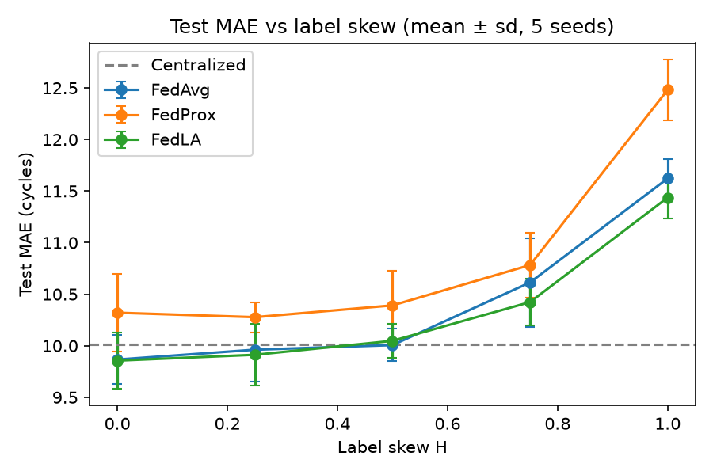
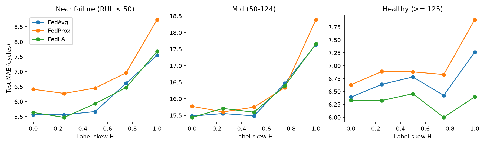
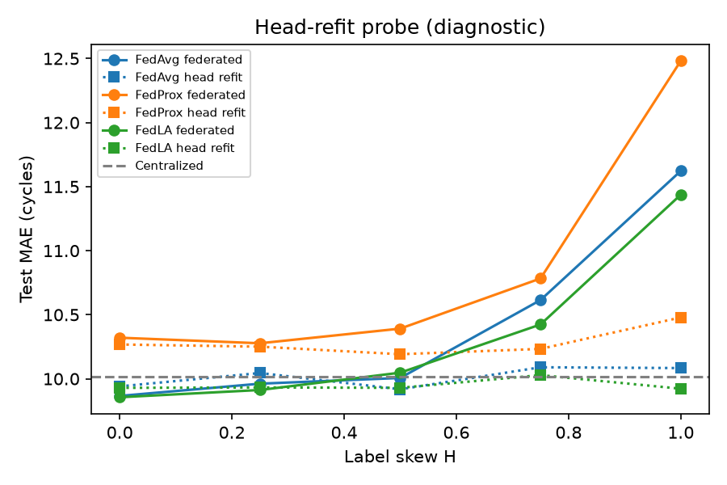

# Federated Remaining-Useful-Life Prediction under Label Skew: Where Does the Damage Come From, and Can a Label-Aware Correction Recover It?

Team Cappuccino · CS F407 Artificial Intelligence · DRAFT (results generated from run logs; review before submission)

## Abstract

Federated learning lets operators who cannot pool their engine data train one Remaining-Useful-Life (RUL) model, but
each operator's engines may cover a different range of lifetimes (label skew). On NASA C-MAPSS FD004 with five
simulated clients and a skew knob H, we ran a pre-registered, paired comparison of FedAvg, FedProx and FedLA, a
label-aware loss reweighting introduced here (75 main runs: 3 methods × 5 skew levels × 5 seeds), plus a life-stage breakdown of the error
and a head-refit probe. FedAvg matches centralized training without skew (test MAE 9.87 vs 10.01 cycles) and loses
1.76 cycles (95% CI 1.64 to 1.86) at extreme skew. FedProx is worse than FedAvg at every skew level (+0.47 cycles
pooled over H ≥ 0.5). FedLA is 0.11 cycles better (95% CI −0.20 to −0.03), but the pre-registered test is not
significant after Holm correction (p = 0.055), and its gain is confined to healthy engines, because lifetime skew
only changes how many capped labels a client holds. The penalty itself comes mostly from mid-life and near-failure
engines and, by the probe, sits in the regression head: refitting only the head on the frozen federated features
removes 1.54 of the 1.76 cycles (test MAE 10.08), while the same refit on an untrained network reaches only 13.94.
Under RUL label skew the shared features survive; the head is where a correction should aim.

## 1. Introduction

Turbofan engines degrade over their life, and predicting their Remaining Useful Life (RUL, in operating cycles) lets an
operator schedule maintenance before failure. When engine data is held by several operators (e.g. airlines) that cannot
pool it, federated learning (FL) trains one model without moving the data: each client trains locally, a server
averages the model weights.

Real fleets differ in how their engines are used, so clients do not see the same *labels*: one operator's engines may
mostly be young and healthy, another's mostly near failure. This **label skew** is a known weakness of FL. Prior work
already compared centralized, local-only and federated RUL models (Kamei & Taghipour, 2023) and found that generic
drift corrections such as FedProx or SCAFFOLD explain almost none of the variance under RUL label skew (Ozdemir et
al., PHME 2026; FedCMAPSS 2026). We use these as baselines and as a replication check, not as our contribution.

**Research question.** Generic drift correction (FedProx) barely helps under RUL label skew. Where does the damage come
from, and does a label-aware correction designed for regression recover it?

We answer with a controlled, pre-registered study on NASA C-MAPSS FD004 with three arms on identical partitions:
FedAvg, FedProx, and **FedLA** (Federated Label-Aware loss reweighting, introduced here), and two analyses: error by
life stage, and a head-refit probe that separates damage in the learned features from damage in the regression head.

## 2. Data

- **Dataset.** NASA C-MAPSS FD004: 249 training engines run to failure, 248 test engines cut before failure with their
  true RUL given separately; six operating conditions and two fault modes. FD001 (one condition) is used only as a
  pipeline sanity check. Raw files are verified by SHA-256 (DECISIONS P4).
- **Split.** 50 of the 249 training engines are held out for validation, chosen once with a fixed seed and never
  changed (D1). The split is by engine and happens before windowing, so no engine appears in two splits (rule 1).
- **Operating conditions.** A cycle's condition is its three settings rounded to whole numbers (D2).
- **Normalisation.** Each sensor is z-scored per operating condition with statistics from training engines only (D3).
  Sensors that are constant within every condition are dropped (D4): 17 sensors are kept. The input per cycle is the
  17 normalised sensors plus a one-hot of the condition: 23 features (D5).
- **Windows and labels.** Inputs are 30-cycle windows. Training and validation use every window (stride 1) with label
  min(T − t, 125) at the window's last cycle (D6): 43,064 training windows from 199 engines, 10,964 validation windows
  from 50 engines. The test input is the last 30 cycles of each test engine, left-padded by repeating the first cycle
  when shorter (D7); test labels are capped at 125 for the headline metric (D8): 248 test windows.
- **Leakage audit.** Before reporting, we checked that the scaler sees only training engines, that no test window is
  identical to any training or validation window, that no engine is in both training and validation, and that test
  MAE rises from about 10 to 48.6 cycles when test labels are shuffled across engines.

## 3. Model

A GRU reads the 30-cycle window; its hidden state after the last cycle goes to a small head
(Linear(h, h/2) → ReLU → Linear(h/2, 1)) that outputs RUL/125 (M1). Training minimises MSE on RUL/125 with Adam, batch
256 and gradient-norm clipping at 1.0 (M3). Every evaluation, for every arm, uses one function: prediction =
clamp(output × 125, 0, 125) (M4).

**Tuning (once, centralized, validation only).** Grid hidden {32, 64, 128} × layers {1, 2} × lr {0.001, 0.003}, seed 1;
the top two were rerun on seeds 101–103 and the lower mean validation MAE won (M2, M6). The top two of the screen
differed by only 0.005 cycles; on the confirmation seeds GRU 128 × 2 (lr 0.001, dropout 0.2) won with mean 9.187 vs
9.399, lower on all three seeds. The model is frozen from here on and never retuned on federated results (M7).

## 4. Federated setup

- **Clients.** K = 5 simulated clients (no real sites; no privacy guarantees are claimed: no differential privacy, no
  secure aggregation).
- **Label-skew partitioner.** Training engines are sorted by lifetime and cut into K blocks. An engine in block b goes
  to client b with probability H, otherwise to a uniformly random client: P(client k) = H·1[b = k] + (1 − H)/K
  (PT1–PT3). H = 0 is an IID split; H = 1 gives each client one band of lifetimes, i.e. one slice of the RUL range.
  Validation engines are routed by the same rule over their own lifetime blocks, so each client also has its own
  validation engines (PT5). One manifest file per (H, seed) stores the assignment with a SHA-256 hash; all three arms
  read the same file (paired design, PT11). Skew (mean Wasserstein-1 distance between each client's training labels and
  all training labels) rises strictly with H, from 1.34 cycles at H = 0 to 10.40 at H = 1 (PT6).
- **Training.** All clients train in every round (F1). Each client starts from the global weights, builds a fresh Adam
  optimiser and trains E local epochs (F2); the server averages client weights weighted by their number of training
  windows (FedAvg aggregation, F3). Every run does all R rounds; the reported model is the round with the lowest global
  validation MAE, including round 0 (the untrained start) (F6, F10).
- **FedAvg** is the plain algorithm above.
- **FedProx** adds a proximal term to the client loss: MSE + (μ/2)·Σ(p − g)², with g the global weights copied before
  local training (F4). Same code path as FedAvg with μ > 0.
- **FedLA (ours).** Before round 1, each client sends a histogram of its training labels over 6 fixed bins
  ([0,25), [25,50), [50,75), [75,100), [100,125) and the capped bin {125}). The server sums them and sends back the
  global histogram. Each client then weights its per-window squared error by w(y) = p_global(bin) / p_local(bin),
  clipped to [0.1, 10] and renormalised to mean 1 on that client (LA1–LA5). Aggregation stays plain FedAvg, so FedLA
  differs from FedAvg only in these weights. The exchange costs K × 6 counts up and 6 down, once (LA6).
- **Two engines.** A plain-PyTorch reference simulator runs all registered experiments; a Flower 1.42 app reproduces
  it for all three arms on the test slice over 2 rounds (Gate 2, `tests/test_gate2.py`: per-round validation MAE within
  1e-4 cycles, weights within a relative 1e-5; the only difference is the order in which the server adds client
  updates; F11–F13).

## 5. Experimental protocol

- **Settings chosen on validation only, on seeds that are never reported** (F5, F7, M6):
  - *Pilot (F7):* FedAvg, E ∈ {1, 3} × lr ∈ {0.001, 0.000333}, H ∈ {0, 1}, seeds 101–102, R = 60. Best at H = 0:
    E = 1, lr = 0.001 (validation MAE 8.909); FedAvg degrades at H = 1 (10.330), confirming the study's premise, so
    K = 5 is kept (F14).
  - *μ selection (F5):* FedProx at H = 1, μ ∈ {0.001, 0.01, 0.1, 1}, seeds 101–103. μ = 0.001 won (mean validation MAE 11.129), the smallest value in the grid; error rose steadily
    with μ (12.133, 12.589, 13.274). Even μ = 0.001 was worse than FedAvg on validation at H = 1 (F15).
- **Main grid.** 3 arms × H ∈ {0, 0.25, 0.5, 0.75, 1} × seeds 1–5 = 75 runs, paired by (H, seed).
- **Baselines.** Centralized training on all training engines (seeds 1–5) and local-only training (each client alone)
  at H = 0 and H = 1 (E5).
- **Metrics.** Headline: test MAE over the 248 test engines. Also RMSE, NASA score (late predictions penalised harder),
  worst-client validation MAE (E2), rounds to reach 110% of centralized validation MAE (censored runs counted, E3),
  bytes communicated (F8), and test MAE by life stage: near failure < 50, mid 50–124, healthy ≥ 125 (E4).
- **Head-refit probe (diagnostic).** For each main run, the best global model's GRU is frozen, the head is replaced by a
  fresh one and trained on all training windows (pooled) with early stopping on validation, then scored on test (E6).
  If the error returns near centralized, the skew damage is mainly in the head; otherwise in the features. This is a
  diagnostic, not a deployable method. **Control (E20):** the same refit on an *untrained* GRU (seeds 1–5) shows how
  far a head trained on pooled data gets without learned features.
- **Statistics (pre-registered, `docs/PREREGISTRATION.md`).** Differences are (method − FedAvg) in test MAE, paired by
  (H, seed). Primary: FedLA vs FedAvg (P1) and FedProx vs FedAvg (P2), pooled over H ≥ 0.5 (15 pairs), one-sided exact
  Wilcoxon signed-rank, Holm-corrected, α = 0.05. Secondary (exploratory): per-H paired bootstrap 95% intervals
  (10,000 resamples) and per-H Wilcoxon (5 pairs, smallest possible p = 1/32).
- **Compute and reproducibility.** Every registered run comes from a clean git commit and saves its resolved config,
  manifest hash, per-round log, metrics, best checkpoint and test predictions; every number in this report is
  regenerated from those files by `python -m rulfl.analysis` (E8, E15, E16). Tuning ran on CPU; from Gate 1 on, every
  run used one NVIDIA RTX 3050 laptop GPU in deterministic mode (M8). Runs repeat bit-for-bit with the same seed.

## 6. Results

All numbers and tables in this section are copied unchanged from `results/summary.md` and the CSV files next to it,
which `python -m rulfl.analysis` generates from the run folders (rule 6). Test MAE is in cycles; lower is better.
Differences are (method − FedAvg), paired by (H, seed): negative means the method is better.

### 6.1 Baselines and the skew penalty (premise, S1)

| H | fedavg | fedprox | fedla |
|---|---|---|---|
| 0.0 | 9.87 ± 0.24 | 10.32 ± 0.38 | 9.86 ± 0.28 |
| 0.25 | 9.96 ± 0.31 | 10.28 ± 0.15 | 9.91 ± 0.30 |
| 0.5 | 10.01 ± 0.16 | 10.39 ± 0.34 | 10.05 ± 0.17 |
| 0.75 | 10.61 ± 0.43 | 10.78 ± 0.31 | 10.42 ± 0.22 |
| 1.0 | 11.62 ± 0.19 | 12.48 ± 0.29 | 11.44 ± 0.20 |



- **Federation costs nothing without skew.** At H = 0, FedAvg reaches 9.87 ± 0.24, the same as centralized training
  on all training engines (10.01 ± 0.18).
- **Skew hurts, and the damage grows with H.** FedAvg is flat up to H = 0.5 (10.01) and then rises to 10.61 at H = 0.75
  and 11.62 at H = 1. The paired rise from H = 0 to H = 1 is **1.756 cycles, 95% CI [1.642, 1.856]**, positive on
  every seed: the study's premise holds. Partition skew itself rises strictly with H (1.34 → 10.40 cycles of
  Wasserstein-1 distance, `fig_skew.png`).
- **Federation still beats training alone.** A client training only on its own engines gets 12.69 ± 1.27 at H = 0
  and 17.87 ± 3.98 at H = 1; even the worst federated arm at H = 1 (FedProx, 12.48) is far better than local-only.

| baseline | H | runs | test MAE |
|---|---|---|---|
| centralized | - | 5 | 10.01 ± 0.18 |
| untrained_gru_head_refit | - | 5 | 13.94 ± 0.22 |
| local_only | 0.0 | 25 | 12.69 ± 1.27 |
| local_only | 1.0 | 25 | 17.87 ± 3.98 |

### 6.2 Primary hypotheses (pre-registered)

| | method | pairs | mean diff vs FedAvg | 95% CI | p | p (Holm) | significant |
|---|---|---|---|---|---|---|---|
| P1 | fedla | 15 | -0.112 | [-0.201, -0.025] | 0.0277 | 0.0554 | no |
| P2 | fedprox | 15 | 0.471 | [0.272, 0.659] | 0.9996 | 0.9996 | no |

**Premise (S1):** FedAvg test MAE at H = 1 minus H = 0: 1.756 cycles, 95% CI [1.642, 1.856] (5 seeds).

- **P2, FedProx vs FedAvg: no improvement, as the replication expected; FedProx is in fact worse.** Pooled over H ≥ 0.5, FedProx is 0.471 cycles worse
  than FedAvg (95% CI [0.272, 0.659]); one-sided p = 0.9996. It is worse at every H, including H = 0 (+0.455), and
  most at H = 1 (+0.859, CI [0.702, 1.005]). This replicates, in a stronger form, the published finding that generic
  drift correction does not help under RUL label skew.
- **P1, FedLA vs FedAvg: small improvement, not significant after the pre-registered correction.** Pooled over
  H ≥ 0.5, FedLA is 0.112 cycles better than FedAvg (95% CI [−0.201, −0.025]); the one-sided Wilcoxon gives
  p = 0.0277, which becomes **p = 0.0554 after Holm correction** over P1 and P2. Under the pre-registered rule
  (family-wise α = 0.05) P1 is **not supported**. We report this as a null result; the direction and the confidence
  interval suggest a small effect that 15 pairs cannot confirm.

### 6.3 Per-H differences (S2, exploratory)

| method | H | mean diff | 95% CI | Wilcoxon p (less) |
|---|---|---|---|---|
| fedprox | 0.0 | 0.455 | [0.343, 0.575] | 1.0000 |
| fedprox | 0.25 | 0.315 | [0.113, 0.468] | 0.9688 |
| fedprox | 0.5 | 0.385 | [0.170, 0.605] | 1.0000 |
| fedprox | 0.75 | 0.169 | [-0.095, 0.427] | 0.8438 |
| fedprox | 1.0 | 0.859 | [0.702, 1.005] | 1.0000 |
| fedla | 0.0 | -0.010 | [-0.054, 0.025] | 0.4062 |
| fedla | 0.25 | -0.049 | [-0.113, 0.038] | 0.2188 |
| fedla | 0.5 | 0.041 | [-0.026, 0.109] | 0.8438 |
| fedla | 0.75 | -0.191 | [-0.345, -0.022] | 0.0938 |
| fedla | 1.0 | -0.185 | [-0.283, -0.066] | 0.0625 |

FedLA does nothing at H ≤ 0.5 (all intervals cover 0, as expected: with little skew its weights are close to 1) and
is about 0.19 cycles better than FedAvg at H = 0.75 and H = 1, where both intervals exclude 0. That is about a tenth
of the 1.76-cycle skew penalty. These per-H results are exploratory; with 5 pairs the smallest possible p is 1/32.

### 6.4 Where the damage comes from: life stage (S3)

| method | H | near failure (<50) | mid (50-124) | healthy (125) |
|---|---|---|---|---|
| fedavg | 0.0 | 5.57 | 15.48 | 6.39 |
| fedavg | 0.25 | 5.56 | 15.55 | 6.64 |
| fedavg | 0.5 | 5.67 | 15.48 | 6.78 |
| fedavg | 0.75 | 6.61 | 16.47 | 6.42 |
| fedavg | 1.0 | 7.55 | 17.64 | 7.26 |
| fedprox | 0.0 | 6.41 | 15.77 | 6.63 |
| fedprox | 0.25 | 6.27 | 15.60 | 6.89 |
| fedprox | 0.5 | 6.45 | 15.75 | 6.88 |
| fedprox | 0.75 | 6.96 | 16.34 | 6.83 |
| fedprox | 1.0 | 8.74 | 18.39 | 7.89 |
| fedla | 0.0 | 5.64 | 15.44 | 6.33 |
| fedla | 0.25 | 5.47 | 15.71 | 6.32 |
| fedla | 0.5 | 5.93 | 15.59 | 6.46 |
| fedla | 0.75 | 6.47 | 16.39 | 6.00 |
| fedla | 1.0 | 7.68 | 17.66 | 6.40 |

Test engines per stage: near_failure 79, mid 102, healthy 67 (total 248).

Rise from H = 0 to H = 1 by stage, and each stage's share of the rise in overall test MAE:

| method | stage | MAE H=0 | MAE H=1 | change | contribution to overall change (cycles) |
|---|---|---|---|---|---|
| fedavg | near_failure | 5.57 | 7.55 | +1.98 | +0.631 |
| fedavg | mid | 15.48 | 17.64 | +2.16 | +0.889 |
| fedavg | healthy | 6.39 | 7.26 | +0.87 | +0.236 |
| fedavg | **overall** | 9.87 | 11.62 | +1.76 | +1.756 |
| fedprox | near_failure | 6.41 | 8.74 | +2.33 | +0.742 |
| fedprox | mid | 15.77 | 18.39 | +2.62 | +1.077 |
| fedprox | healthy | 6.63 | 7.89 | +1.26 | +0.342 |
| fedprox | **overall** | 10.32 | 12.48 | +2.16 | +2.161 |
| fedla | near_failure | 5.64 | 7.68 | +2.04 | +0.650 |
| fedla | mid | 15.44 | 17.66 | +2.22 | +0.914 |
| fedla | healthy | 6.33 | 6.40 | +0.06 | +0.017 |
| fedla | **overall** | 9.86 | 11.44 | +1.58 | +1.581 |



Overall test MAE is an engine-weighted average of the three stages, so the rise from H = 0 to H = 1 splits exactly
into one contribution per stage (last column; contributions add up to the overall change).

- **For FedAvg, the penalty is in the degrading engines, not the healthy ones.** Of the 1.756-cycle rise, mid-life
  engines (RUL 50–124) contribute 0.889 cycles (51%), near-failure engines 0.631 (36%) and healthy (capped) engines
  0.236 (13%). Relative to their H = 0 error, near-failure engines are hurt most (+36%, 5.57 → 7.55 cycles).
- **At H = 1, FedLA's gain is entirely in the healthy stage.** FedLA removes almost all of the healthy-stage damage (rise +0.06
  vs +0.87 for FedAvg) but changes nothing for near-failure (+2.04 vs +1.98) or mid-life engines (+2.22 vs +2.16).
  So the label-aware weights fix the part of the penalty that is cheapest to fix and leave the part that matters
  most for maintenance untouched.
- **FedProx is worse in every stage,** most of all near failure at H = 1 (8.74 vs 7.55).

Why FedLA can only touch the healthy stage is visible in each client's label mix at H = 1 (generated from the data
and the manifest):

| client | engines | mean lifetime | near-failure windows per engine | 0-24 | 25-49 | 50-74 | 75-99 | 100-124 | 125 |
|---|---|---|---|---|---|---|---|---|---|
| all | 199 | 245 | 50.0 | 0.116 | 0.116 | 0.116 | 0.116 | 0.113 | 0.425 |
| 0 | 40 | 163 | 50.0 | 0.186 | 0.186 | 0.186 | 0.186 | 0.168 | 0.088 |
| 1 | 40 | 196 | 50.0 | 0.150 | 0.150 | 0.150 | 0.150 | 0.150 | 0.252 |
| 2 | 40 | 234 | 50.0 | 0.122 | 0.122 | 0.122 | 0.122 | 0.122 | 0.391 |
| 3 | 40 | 278 | 50.0 | 0.100 | 0.100 | 0.100 | 0.100 | 0.100 | 0.498 |
| 4 | 39 | 358 | 50.0 | 0.076 | 0.076 | 0.076 | 0.076 | 0.076 | 0.620 |

Every engine has exactly 50 near-failure windows, on every client, and below the cap each client's mix is nearly flat
with the same shape (the short-lived client has slightly fewer windows at RUL 100–124). Lifetime skew changes only the share of capped windows (0.088 on client 0 to 0.620 on client 4).

### 6.5 Features or head? Head-refit probe (S4, diagnostic only)

Frozen GRU, fresh head trained on pooled training windows. Not a deployable method.

| method | H | runs | federated test MAE | after head refit | change (refit - federated) | 95% CI | refit: near failure / mid / healthy |
|---|---|---|---|---|---|---|---|
| fedavg | 0.0 | 5 | 9.87 | 9.94 | +0.074 | [-0.105, 0.286] | 6.38 / 15.26 / 6.04 |
| fedavg | 0.25 | 5 | 9.96 | 10.04 | +0.083 | [-0.175, 0.341] | 6.23 / 15.64 / 6.02 |
| fedavg | 0.5 | 5 | 10.01 | 9.92 | -0.088 | [-0.154, -0.007] | 5.78 / 15.12 / 6.89 |
| fedavg | 0.75 | 5 | 10.61 | 10.09 | -0.525 | [-0.722, -0.327] | 6.12 / 15.56 / 6.43 |
| fedavg | 1.0 | 5 | 11.62 | 10.08 | -1.539 | [-1.828, -1.346] | 6.15 / 15.77 / 6.07 |
| fedprox | 0.0 | 5 | 10.32 | 10.27 | -0.053 | [-0.210, 0.075] | 6.66 / 15.41 / 6.69 |
| fedprox | 0.25 | 5 | 10.28 | 10.25 | -0.026 | [-0.184, 0.185] | 6.43 / 15.44 / 6.85 |
| fedprox | 0.5 | 5 | 10.39 | 10.19 | -0.200 | [-0.271, -0.125] | 6.57 / 15.33 / 6.65 |
| fedprox | 0.75 | 5 | 10.78 | 10.23 | -0.550 | [-0.800, -0.245] | 6.53 / 15.42 / 6.71 |
| fedprox | 1.0 | 5 | 12.48 | 10.48 | -2.003 | [-2.224, -1.814] | 7.13 / 15.67 / 6.52 |
| fedla | 0.0 | 5 | 9.86 | 9.93 | +0.073 | [-0.150, 0.370] | 6.44 / 15.31 / 5.86 |
| fedla | 0.25 | 5 | 9.91 | 9.93 | +0.020 | [-0.217, 0.327] | 6.04 / 15.38 / 6.23 |
| fedla | 0.5 | 5 | 10.05 | 9.93 | -0.118 | [-0.225, 0.002] | 5.78 / 15.23 / 6.75 |
| fedla | 0.75 | 5 | 10.42 | 10.03 | -0.395 | [-0.477, -0.323] | 6.02 / 15.67 / 6.16 |
| fedla | 1.0 | 5 | 11.44 | 9.92 | -1.515 | [-1.710, -1.356] | 6.10 / 15.44 / 6.03 |



- **The damage is in the head.** For FedAvg at H = 1, refitting only the head on the frozen federated GRU lowers test
  MAE by 1.539 cycles (95% CI [−1.828, −1.346]), from 11.62 to 10.08, next to centralized training (10.01). The
  penalty from H = 0 to H = 1 was 1.756 cycles, so the refit removes 1.54 of it. The same holds for FedLA
  (11.44 → 9.92) and FedProx (12.48 → 10.48).
- **The refit is not just extra training.** At H = 0, where there is no skew to undo, the refit changes nothing
  (FedAvg +0.074, CI [−0.105, 0.286]; FedLA +0.073, CI [−0.150, 0.370]). Its gain grows with skew: −0.088 at
  H = 0.5, −0.525 at H = 0.75, −1.539 at H = 1 (FedAvg).
- **The learned features carry the skill.** The same refit on an *untrained* GRU (control, E20) reaches only
  13.94 ± 0.22 (see Baselines). So even at H = 1 the federated GRU learned features almost as useful as centralized
  ones; what skew breaks is the mapping from those features to RUL.
- **The refit repairs the stages FedLA could not.** For FedAvg at H = 1, after the refit: near failure 6.15
  (federated 7.55; H = 0: 5.57), mid-life 15.77 (17.64; 15.48), healthy 6.07 (7.26; 6.39).
- **FedProx's features are slightly worse as well.** Its refit stays above FedAvg's at every H (10.27 vs 9.94 at
  H = 0, 10.48 vs 10.08 at H = 1), so the proximal term costs a little in the features too, not only in the head.

This is a diagnostic: the refitted head is trained on all training windows pooled, which no client could do. It
locates the damage; it is not a method.

### 6.6 Secondary metrics

| method | H | RMSE | NASA score | worst-client val MAE | runs reaching 110% | median rounds to 110% |
|---|---|---|---|---|---|---|
| fedavg | 0.0 | 14.79 | 1144 | 11.05 | 5/5 | 20.0 |
| fedavg | 0.25 | 14.87 | 1207 | 11.93 | 5/5 | 19.0 |
| fedavg | 0.5 | 14.90 | 1240 | 12.49 | 5/5 | 18.0 |
| fedavg | 0.75 | 15.93 | 1788 | 15.29 | 4/5 | 23.0 |
| fedavg | 1.0 | 16.91 | 2009 | 19.80 | 0/5 | n/a |
| fedprox | 0.0 | 14.92 | 1231 | 11.36 | 5/5 | 36.0 |
| fedprox | 0.25 | 14.96 | 1276 | 12.27 | 5/5 | 35.0 |
| fedprox | 0.5 | 15.24 | 1380 | 12.73 | 4/5 | 37.5 |
| fedprox | 0.75 | 15.73 | 1679 | 15.50 | 3/5 | 42.0 |
| fedprox | 1.0 | 17.69 | 2296 | 20.37 | 0/5 | n/a |
| fedla | 0.0 | 14.72 | 1126 | 10.97 | 5/5 | 17.0 |
| fedla | 0.25 | 14.80 | 1221 | 12.13 | 5/5 | 16.0 |
| fedla | 0.5 | 15.14 | 1318 | 12.30 | 5/5 | 18.0 |
| fedla | 0.75 | 15.78 | 1779 | 15.26 | 5/5 | 21.0 |
| fedla | 1.0 | 16.83 | 2090 | 20.07 | 0/5 | n/a |

- **Rounds to 110% of centralized validation MAE** (threshold 9.894): FedAvg reaches it in a median of 18–23 rounds
  up to H = 0.75 and FedLA in 16–21; FedProx needs 35–42 rounds and fails more often (3/5 at H = 0.75). At H = 1
  **no run of any method reaches it** (0/15, censored and counted, never dropped).
- **Worst-client validation MAE** rises from about 11 at H = 0 to about 20 at H = 1 for all three methods; no method
  protects the worst-served client.
- **RMSE and NASA score** follow MAE. At H = 1, FedLA's NASA score (2090) is slightly worse than FedAvg's (2009)
  although its MAE is better: the NASA score is a sum dominated by a few late predictions (E13).
- **Bytes communicated:** 398,748,000 bytes per FedAvg or FedProx run = 60 rounds × 5 clients × 2 directions ×
  166,145 parameters × 4 bytes. FedLA adds 240 bytes once (5 clients × 6 counts, up and down, LA6): 398,748,240.

## 7. Discussion

**Answer to the research question.** Under lifetime label skew the damage is real (1.76 cycles at H = 1), it comes mostly from the engines that matter
for maintenance (mid-life 0.889 and near failure 0.631 of the 1.756 cycles), and it sits in the regression head, not
in the learned features: a head refitted on the frozen federated features recovers almost all of it, while the
same head on untrained features is far worse. Generic drift correction (FedProx) does not help and in our setting
hurts. The label-aware correction (FedLA) gives a small improvement that is not significant under the pre-registered
test and reaches only the healthy stage. In short: the damage is located in the head, and a correction that
rebalances label frequencies does not reach it.

**Why FedProx hurts here.** FedProx was tuned fairly: μ was chosen on validation at H = 1 on separate seeds, and the
winner was the smallest value in the grid (0.001), with error rising steadily as μ grew (F15). Even so, it is worse
than FedAvg at every H, and slower to converge. A likely reason (not tested here) is scale: the loss is MSE on RUL/125,
around 0.006 late in training (F15), so even a small proximal term is comparable to the loss and holds every client close to
the previous global model. Under label skew the useful direction for a client is exactly the one that moves away from
the global model on its own RUL range, which the proximal term discourages. Generic drift correction treats the
symptom (clients drifting apart) rather than the cause (each client sees a different slice of the target).

**Why FedLA helps only a little, and only on healthy engines.** The client label-mix table explains it. Every
training engine runs to failure, so each one has exactly one window for every RUL value from 0 up to the cap
(50 near-failure windows per engine on every client). Sorting engines by lifetime therefore changes only one thing
about a client's labels: the share of capped "healthy" windows, from 8.8% on the short-lived client to 62% on the
long-lived one at H = 1. Below the cap, every client's label mix has nearly the same flat shape. FedLA reweights label
frequencies, so all it can do here is rebalance capped against uncapped windows, and that is exactly the stage it
fixes. The near-failure and mid-life damage cannot be a label-frequency problem, because those frequencies already
match across clients. Our explanation (post hoc, not tested directly): what differs between clients is *how fast
their engines degrade*. Short-lived engines wear out quickly, long-lived ones slowly, so the same sensor state means
fewer remaining cycles on one client than on another. The probe fits this picture: the shared GRU still describes the
engines' state well, and what goes wrong is the last step, the head, which turns that state into a number of cycles
and is averaged from clients that each calibrated it to their own degradation speed. Reweighting labels cannot fix
that calibration; a head trained on pooled windows fixes all three stages at once.

**Federation is still worth it.** Even at H = 1, every federated arm is 5.4 to 6.4 cycles better than a
client training alone (17.87), and at H ≤ 0.5 FedAvg matches centralized training. The skew penalty is real but smaller
than the gain from collaborating.

**What we would do next.** The probe points at the head. A federated method that targets it would test whether its gain can be had without
pooling labels: for example, train the shared GRU federatedly, then calibrate or retrain only the head from
aggregated feature statistics instead of raw data, in the spirit of classifier calibration for non-IID federated
learning (Luo et al., "No Fear of Heterogeneity: Classifier Calibration for Federated Learning with Non-IID Data",
NeurIPS 2021). Other directions: a skew knob that changes degradation speed independently of lifetime, K = 10
clients, and more seeds so that P1 has enough power to settle a 0.1-cycle effect.

## 8. Limitations

- **Simulated federation.** Clients are partitions of one public dataset on one machine, not real operators.
- **Pooled normalisation.** Scaling statistics are computed over all training engines (D3); a real federation could not
  pool raw statistics. This keeps inputs identical across H and arms, so differences come from label skew alone.
- **FedLA reveals label distributions.** The histograms tell the server each client's label distribution (LA7). In the
  Flower engine the global histogram is reconstructed from the manifest rather than exchanged (F13).
- **Statistical power.** With 5 seeds, per-H tests are weak (smallest one-sided p = 1/32); the pooled tests and the
  confidence intervals carry the evidence (E7).
- **Worst-client MAE is noisy at mid H,** where some clients receive only 5–6 validation engines (PT9).
- **The NASA score is a sum,** so one very late prediction can dominate it; read it alongside MAE (E13).
- **FedLA bins and clip were fixed in advance,** not tuned on validation (LA1, LA2).
- **The probe uses pooled labels.** The refitted head sees all training windows at once, which no client could do;
  it measures where the damage is, not what a federated method can achieve.
- **Analyses added after seeing the main results.** The life-stage split of the penalty, the client label-mix table,
  the probe's confidence intervals (E19) and the probe control (E20) were added after a first look at the main grid.
  They are descriptive and change no pre-registered test; the FedLA mechanism in Section 7 is a post-hoc explanation.
- **Hardware.** Model tuning ran on CPU and all later runs on GPU (M8); tuning only selected the model, so no reported
  comparison mixes devices.

## 9. Reproducing the results

```
pip install -r requirements-gpu.lock && pip install -e . --no-deps     # (requirements.lock for CPU)
pytest -q
python -m rulfl.batch plan central > jobs.txt && python -m rulfl.batch run jobs.txt --jobs 2   # then the same for
#   main, local, probe, probectl (each from a clean git tree; see docs/DECISIONS.md E16)
python -m rulfl.analysis                                                  # results/ from runs/
python -m rulfl.batch index                                               # results/index.csv: one row per run
```
